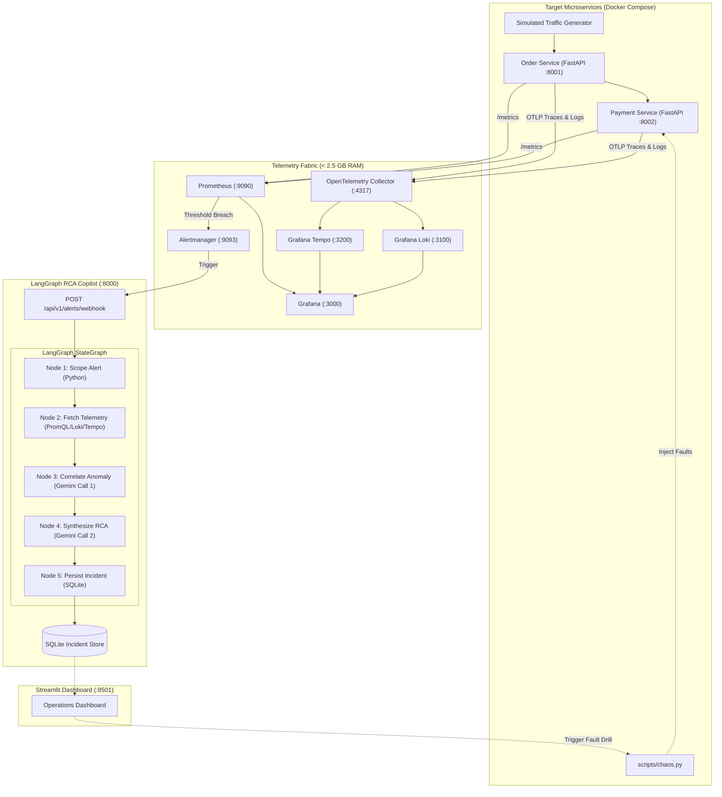

# 🛡️ Agentic AIOps Root Cause Analysis (RCA) Copilot

An autonomous AIOps Root Cause Analysis (RCA) Copilot that diagnoses microservice incidents in real-time using **LangGraph**, **Gemini Flash**, and a local **OpenTelemetry + Prometheus + Tempo + Loki** observability stack.

Built specifically to operate reliably within **free-tier AI API limits (15 RPM)** and on standard developer hardware (< 3 GB RAM footprint).

---

## 🌟 Key Architectural Highlights

- **Deterministic LangGraph Pipeline:** Replaces unpredictable autonomous agent debates with a 5-node state graph. Exactly **2 LLM calls per incident**, completely eliminating HTTP 429 quota exhaustion.
- **Zero Query Hallucination:** Python tools execute pre-baked, parameterized PromQL and LogQL query contracts. The LLM is never asked to generate raw query strings.
- **Lightweight Observability Fabric (< 2.6 GB RAM):** Deploys Prometheus, Tempo, Loki, Alertmanager, Grafana, and two instrumented FastAPI microservices inside a memory-capped Docker Compose environment.
- **Interactive Chaos Simulator (`scripts/chaos.py`):** One-click deterministic fault injection to test downstream latency, 500 error cascades, and CPU saturation.
- **Operations Dashboard (Streamlit):** Visual interface for triggering chaos scenarios, inspecting live RCA reports, and launching pre-filtered Grafana deep-links.

---

## 🏗️ System Architecture



---

## 🚀 Quickstart Guide

### 1. Pre-Flight Verification
Run the system pre-flight check to verify your Python version, Docker CLI, memory headroom, and port availability:
```bash
python scripts/verify_stack.py
```

### 2. Configure Environment
Copy `.env.example` to `.env` and set your Google Gemini API Key:
```bash
cp .env.example .env
# Edit .env and set GEMINI_API_KEY=AIzaSy...
```
*(If no API key is provided, the copilot automatically falls back to an offline mock client for safe local testing).*

### 3. Launch the Stack
Start all 10 containers with Docker Compose:
```bash
docker compose up -d --build
```

### 4. Access Services
| Component | URL | Purpose |
| :--- | :--- | :--- |
| **Streamlit Operations UI** | [http://localhost:8501](http://localhost:8501) | Live RCA viewer & Chaos simulator |
| **Grafana Dashboards** | [http://localhost:3000](http://localhost:3000) | Microservices telemetry & trace waterfall |
| **Prometheus** | [http://localhost:9090](http://localhost:9090) | Metrics scraping & active alert rules |
| **Alertmanager** | [http://localhost:9093](http://localhost:9093) | Webhook dispatcher |
| **RCA Copilot Backend** | [http://localhost:8000/docs](http://localhost:8000/docs) | Interactive Swagger OpenAPI docs |
| **Order Service** | [http://localhost:8001/health](http://localhost:8001/health) | Target gateway microservice |
| **Payment Service** | [http://localhost:8002/health](http://localhost:8002/health) | Target downstream microservice |

---

## 🧪 Chaos Engineering & RCA Scenarios

### Scenario 1: Downstream Payment Latency (504 Gateway Timeout)
Simulates a downstream dependency slowing down (e.g., slow database query or payment gateway lag).
```bash
python scripts/chaos.py --scenario 1 --delay 5.0
```
- **Signal:** `order-service` HTTP 504 timeouts spike; Tempo distributed traces show `payment-service: /pay` span consuming > 5000ms.
- **RCA Output:** Identifies downstream latency in `payment-service` and recommends circuit breaker configuration.

### Scenario 2: Unhandled 500 Exception Spike
Simulates database deadlock or unhandled exception cascade.
```bash
python scripts/chaos.py --scenario 2
```
- **Signal:** High 5xx error rate; Loki structured logs capture Python tracebacks.
- **RCA Output:** Pinpoints database lock failure in `payment-service` and provides immediate remediation.

### Scenario 3: CPU Saturation
Burns CPU cycles on the target service for 12 seconds.
```bash
python scripts/chaos.py --scenario 3 --duration 12
```

### Restore Healthy Baseline
```bash
python scripts/chaos.py --scenario reset
```

---

## 🔬 Testing & Verification

Run the end-to-end LangGraph pipeline test locally without needing any running containers:
```bash
python tests/test_rca_graph.py
```

Generate continuous background traffic:
```bash
python scripts/seed_traffic.py --interval 1.5
```

---

## 📁 Repository Structure

```
aiops-rca-copilot/
├── docker-compose.yml              # Unified container orchestrator (< 2.6 GB RAM)
├── .env.example                    # Environment variable template
├── requirements.txt                # Python project dependencies
├── README.md                       # Comprehensive guide & architecture documentation
│
├── apps/                           # Target Microservices Under Test
│   ├── order_service/              # FastAPI + OpenTelemetry + Prometheus /metrics
│   └── payment_service/            # FastAPI + Chaos injection endpoints
│
├── observability/                  # Memory-capped Observability Configs
│   ├── prometheus/                 # Scrape configs & alert rules
│   ├── alertmanager/               # Webhook routing to Copilot backend
│   ├── loki/                       # Filesystem log store
│   ├── tempo/                      # Distributed trace store
│   ├── otel-collector/             # OTLP trace & log routing
│   └── grafana/                    # Auto-provisioned datasources & dashboard
│
├── copilot/                        # Core RCA Engine & Backend
│   ├── backend/                    # FastAPI webhook receiver & incident API
│   ├── graph/                      # LangGraph StateGraph & 5-node pipeline
│   │   ├── state.py                # Typed IncidentState & Pydantic RCAReport
│   │   ├── graph.py                # StateGraph assembler
│   │   └── nodes/                  # Scope, Telemetry, Correlate, Synthesize, Persist
│   ├── telemetry/                  # Parameterized PromQL, Loki, and Tempo clients
│   ├── storage/                    # SQLite incident persistence repository
│   └── llm/                        # Rate-limited Gemini client (10 RPM guardrail)
│
├── ui/                             # Streamlit Operations Dashboard
├── scripts/
│   ├── chaos.py                    # Deterministic failure injection CLI
│   ├── verify_stack.py             # Pre-flight environment check
│   └── seed_traffic.py             # Baseline traffic generator
└── tests/                          # End-to-end integration tests
```
