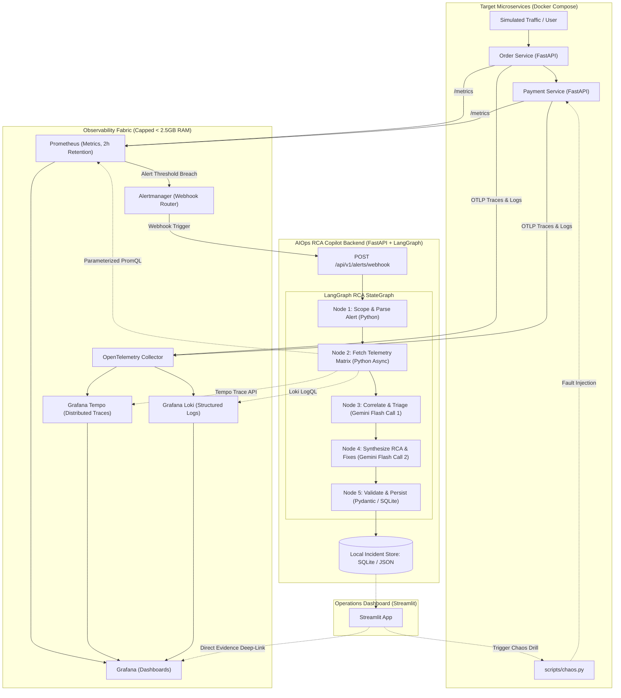

# Production Implementation Plan: Agentic AIOps Root Cause Analysis (RCA) Copilot

**Architecture Decisions Locked:**
- **Agent Orchestrator:** LangGraph (StateGraph with explicit typed state & deterministic nodes)
- **Runtime Environment:** 100% Local Docker Compose (Microservices, Observability Stack, Backend, UI)
- **Target Hardware Envelope:** 16 GB RAM Laptop (strictly budgeted < 4 GB total container usage)
- **LLM Engine:** Google Gemini Flash (Hardened for Free-Tier 15 RPM quota)

---

## 1. Foundational Architecture & Design Principles

This plan resolves the 4 core failure modes identified during feasibility analysis:

### 1.1 The Local RAM Trap $\rightarrow$ Docker Compose Micro-Stack
Running Kubernetes (Kind/Minikube) with a full Helm-based observability stack exhausts 16 GB laptops through JVM/Prometheus cache pressure.
* **Solution:** A unified `docker-compose.yml` deploying minimal, memory-capped OSS containers.
* **Memory Budget Enforcement:**
  - `prometheus`: 512 MB (storage retention capped at 2 hours / 1 GB max disk)
  - `tempo`: 384 MB (local block storage)
  - `loki`: 384 MB (single-binary filesystem store)
  - `grafana`: 256 MB (pre-provisioned datasources & dashboards)
  - `alertmanager`: 128 MB (webhook router)
  - `otel-collector`: 192 MB (OTLP pipeline)
  - Target Microservices (FastAPI $\times$ 2): 256 MB combined
  - RCA Copilot Backend + Streamlit UI: 512 MB combined
  - **Total System Footprint:** **~2.6 GB RAM** (leaving > 13 GB for OS, IDE, and Docker daemon).

### 1.2 The Gemini Free-Tier Bottleneck (15 RPM) $\rightarrow$ Deterministic LangGraph
Autonomous multi-agent roleplay (e.g. CrewAI hierarchical debate) burns 5–10 LLM calls per minute on agent-to-agent negotiations, triggering HTTP 429 quota exhaustion.
* **Solution:** LangGraph `StateGraph` where telemetry fetching and alert scoping are **pure, non-LLM Python functions**.
* **LLM Budget:** Exactly **2 LLM calls per incident**:
  1. *Call 1 (Correlation Engine):* Evaluates pre-fetched metrics, logs, and traces to identify anomaly patterns.
  2. *Call 2 (Synthesizer Engine):* Formulates the final structured RCA report with remediation steps.
* Total execution time: ~15–25 seconds. Well within the 15 RPM envelope.

### 1.3 Tool Hallucinations $\rightarrow$ Parameterized Query Contracts
LLMs frequently hallucinate PromQL and LogQL syntax (e.g., wrong metric labels, invalid regexes), triggering retry loops that burn API quota.
* **Solution:** The LLM never writes raw PromQL or LogQL.
* Python provides strongly typed telemetry methods:
  - `get_service_error_rate(service_name: str, window_minutes: int)`
  - `get_service_latency_p95(service_name: str, window_minutes: int)`
  - `get_recent_error_logs(service_name: str, limit: int = 15)`
  - `get_slow_or_failing_traces(service_name: str, min_duration_ms: int = 800)`
* The queries are hardcoded, optimized, and injected with verified service parameters.

### 1.4 Incident Reproducibility $\rightarrow$ Deterministic Chaos Engine
Instead of manually triggering failures, a standalone CLI `scripts/chaos.py` injects controlled faults to test the end-to-end telemetry $\rightarrow$ alert $\rightarrow$ RCA pipeline on demand.

---

## 2. System Architecture & Information Flow



---

## 3. LangGraph Orchestration Specification

### 3.1 Typed Incident State (`copilot/graph/state.py`)
```python
from typing import TypedDict, List, Dict, Any, Optional
from pydantic import BaseModel

class IncidentState(TypedDict):
    incident_id: str
    alert_name: str
    target_service: str
    severity: str
    starts_at: str
    time_window_start: str
    time_window_end: str
    
    # Telemetry data collected by deterministic Python tools
    metrics_summary: Dict[str, Any]
    failing_traces: List[Dict[str, Any]]
    error_logs: List[str]
    
    # LLM outputs
    triage_hypotheses: Optional[str]
    rca_report: Optional[Dict[str, Any]]
    
    # Execution metadata
    llm_call_count: int
    execution_status: str
    error_details: Optional[str]
```

### 3.2 Structured Output Schema (`RCAReport`)
Enforced via Pydantic output parsing in Node 4:
```python
class EvidenceItem(BaseModel):
    source: str # 'metrics' | 'traces' | 'logs'
    summary: str
    raw_snippet: str
    grafana_url: Optional[str] = None

class RCAReport(BaseModel):
    incident_id: str
    title: str
    severity: str
    culprit_service: str
    root_cause_category: str # 'DOWNSTREAM_LATENCY' | 'UNHANDLED_EXCEPTION' | 'RESOURCE_EXHAUSTION' | 'CONFIGURATION_ERROR'
    root_cause_explanation: str
    evidence_chain: List[EvidenceItem]
    confidence_score: float # 0.0 to 1.0
    immediate_mitigation: List[str]
    permanent_fix_recommendations: List[str]
```

### 3.3 Node Execution Details

| Node | Type | Purpose | LLM Call? | Notes |
| :--- | :--- | :--- | :--- | :--- |
| **`scope_alert`** | Deterministic Python | Parses Alertmanager payload, computes timestamps ($t_{\text{start}} - 10\text{m}$ to $t_{\text{start}} + 2\text{m}$). | No | Extracts culprit service name and labels. |
| **`fetch_telemetry`** | Deterministic Python | Concurrently queries Prometheus, Loki, and Tempo via parameterized client. | No | Extracts top 5 error logs, worst 3 traces, and key service metrics. Zero hallucination risk. |
| **`correlate_anomalies`** | LLM Step (Gemini Flash) | Prompts Gemini to analyze the telemetry package and identify the causal chain. | **Yes (Call 1)** | Temperature = 0.1. Focused strictly on identifying the failure pattern. |
| **`synthesize_rca`** | LLM Step (Gemini Flash) | Formulates structured `RCAReport` with actionable SRE remediations. | **Yes (Call 2)** | Enforces Pydantic JSON schema. |
| **`persist_report`** | Deterministic Python | Saves final markdown & JSON report to disk / SQLite and formats Grafana URLs. | No | Prepares data for Streamlit dashboard rendering. |

---

## 4. Parameterized Telemetry Contracts (`copilot/telemetry/`)

To prevent LLM query hallucinations, we implement dedicated query wrappers:

1. **`PrometheusClient`**:
   - `get_error_rate(service: str, lookback: str = "5m")`:
     Calculates $\frac{\sum \text{rate}(\text{http\_requests\_total}\{status=\sim"5.."\}[\text{lookback}])}{\sum \text{rate}(\text{http\_requests\_total}[\text{lookback}])}$.
   - `get_p95_latency(service: str, lookback: str = "5m")`:
     Evaluates `histogram_quantile(0.95, sum(rate(http_request_duration_seconds_bucket[lookback])) by (le))`.
   - `get_cpu_memory_usage(service: str)`:
     Fetches container-level CPU & memory working set metrics.

2. **`TempoClient`**:
   - `search_traces(service: str, min_duration: str = "1s", status_code: str = "STATUS_CODE_ERROR", limit: int = 3)`:
     Returns trace IDs, root span duration, and span error tags.
   - `get_trace_waterfall(trace_id: str)`:
     Extracts the parent-child span hierarchy to pinpoint which downstream call timed out.

3. **`LokiClient`**:
   - `query_service_logs(service: str, level: str = "ERROR", limit: int = 15)`:
     Executes `{service="$service"} |= "ERROR"` and formats logs with timestamps.

---

## 5. Failure Injection & Chaos Scenarios (`scripts/chaos.py`)

Three distinct, reproducible scenarios designed for portfolio demonstration:

| Scenario | Injected Fault | Expected Observability Signal | Expected RCA Output |
| :--- | :--- | :--- | :--- |
| **Scenario 1: Downstream Timeout** | Payment service endpoint adds an artificial 5-second sleep. | Order service HTTP 504 errors rise; Tempo trace shows Payment span taking 5000ms while Order waits. | **Root Cause:** Downstream Payment API latency leading to gateway timeout.<br>**Fix:** Add circuit breaker & reduce client timeout. |
| **Scenario 2: Unhandled 500 Exception** | Order service receives a malformed payload or simulated invalid state. | Order service 500 spike in Prometheus; Loki logs capture full Python traceback (`KeyError`/`ValueError`). | **Root Cause:** Unhandled payload validation in Order service processing.<br>**Fix:** Implement schema validation and defensive error handling. |
| **Scenario 3: Resource Starvation** | Chaos script triggers CPU/Memory worker loop on Payment service. | Prometheus alerts on container CPU/Memory threshold; response latency degrades across all endpoints. | **Root Cause:** Compute saturation on Payment service container.<br>**Fix:** Scale replicas or increase container CPU/memory limits. |

---

## 6. Project Directory Layout

```
aiops-rca-copilot/
├── docker-compose.yml              # Core orchestrator: Microservices + Observability + Copilot
├── .env.example                    # GEMINI_API_KEY, ports, configurations
├── README.md                       # Comprehensive setup and demo guide
│
├── apps/                           # Target Microservices Under Test
│   ├── order_service/
│   │   ├── main.py                 # FastAPI order endpoints + OpenTelemetry instrumentation
│   │   ├── Dockerfile
│   │   └── requirements.txt
│   └── payment_service/
│       ├── main.py                 # FastAPI payment endpoints + fault endpoints
│       ├── Dockerfile
│       └── requirements.txt
│
├── observability/                  # Configs for lightweight local stack
│   ├── prometheus/
│   │   ├── prometheus.yml          # Scrape configs for microservices
│   │   └── alert_rules.yml         # Latency, 500 error, service down alerts
│   ├── alertmanager/
│   │   └── alertmanager.yml        # Webhook routing to RCA Copilot
│   ├── loki/
│   │   └── loki-config.yml         # Single-binary filesystem storage config
│   ├── tempo/
│   │   └── tempo-config.yml        # Local trace storage config
│   ├── otel-collector/
│   │   └── otel-collector-config.yml # OTLP pipelines (gRPC/HTTP)
│   └── grafana/
│       ├── provisioning/
│       │   ├── datasources/        # Auto-wired Prometheus, Tempo, Loki datasources
│       │   └── dashboards/         # Auto-provisioned microservice dashboard
│       └── dashboards/
│           └── microservices.json
│
├── copilot/                        # The LangGraph RCA Engine & Backend
│   ├── backend/
│   │   ├── main.py                 # FastAPI backend: /webhook, /incidents, /trigger
│   │   └── Dockerfile
│   ├── graph/
│   │   ├── state.py                # IncidentState TypedDict & Pydantic schemas
│   │   ├── graph.py                # LangGraph StateGraph builder
│   │   └── nodes/
│   │       ├── scope_alert.py      # Node 1
│   │       ├── fetch_telemetry.py  # Node 2
│   │       ├── correlate.py        # Node 3 (Gemini Call 1)
│   │       ├── synthesize.py       # Node 4 (Gemini Call 2)
│   │       └── persist.py          # Node 5
│   ├── telemetry/                  # Deterministic Parameterized Clients
│   │   ├── prometheus_client.py
│   │   ├── tempo_client.py
│   │   └── loki_client.py
│   └── storage/
│       └── incident_db.py          # SQLite repository for historical RCAs
│
├── ui/                             # Operations Dashboard
│   ├── app.py                      # Streamlit application
│   ├── Dockerfile
│   └── requirements.txt
│
└── scripts/
    ├── chaos.py                    # Deterministic Failure Injection CLI
    ├── verify_stack.py             # Pre-flight check (verifies ports, containers, metrics)
    └── seed_traffic.py             # Generates normal background traffic for realistic graphs
```

---

## 7. Phased Implementation Roadmap

### Phase 0: Foundations & Local Environment Sizing (Milestone: Verified Devbox)
- [ ] Initialize project directory and git repository.
- [ ] Create `.env.example` with `GEMINI_API_KEY` and service port mappings.
- [ ] Build `scripts/verify_stack.py` to check Docker daemon, free disk, and memory allocation.
- [ ] Implement rate-limit resilient Gemini LLM wrapper (`langchain-google-genai` with exponential backoff on 429).
- **Deliverable:** Environment configured; Gemini client tested with rate-limit guardrails.

### Phase 1: Observability Fabric & Target Microservices (Milestone: Telemetry Flowing)
- [ ] Write `observability/` configurations with strict memory caps (Prometheus 2h retention, Loki local storage, Tempo local storage).
- [ ] Create `apps/order_service` and `apps/payment_service` with FastAPI and OpenTelemetry auto-instrumentation.
- [ ] Assemble core `docker-compose.yml` and verify that metrics appear in Prometheus, traces in Tempo, and logs in Loki.
- [ ] Define Alertmanager rules (`HighErrorRate`, `ServiceLatencyHigh`) and verify firing states in Alertmanager UI.
- [ ] Build `scripts/seed_traffic.py` to produce clean baseline telemetry.
- **Deliverable:** Full local observability pipeline running under 2.5 GB RAM.

### Phase 2: Parameterized Telemetry Tooling & Chaos Engine (Milestone: Queryable Telemetry & Incidents)
- [ ] Build `scripts/chaos.py` with 3 failure modes: `--mode latency`, `--mode 500-error`, `--mode resource`.
- [ ] Implement `copilot/telemetry/prometheus_client.py` (pre-baked PromQL).
- [ ] Implement `copilot/telemetry/tempo_client.py` (trace waterfall extractor).
- [ ] Implement `copilot/telemetry/loki_client.py` (filtered error log extractor).
- [ ] Write standalone unit/integration tests verifying that after running `chaos.py`, the Python tools retrieve expected signals.
- **Deliverable:** Deterministic telemetry extraction verified without LLM involvement.

### Phase 3: LangGraph RCA Engine & Webhook Backend (Milestone: Autonomous End-to-End RCA)
- [ ] Define `IncidentState` and `RCAReport` Pydantic models.
- [ ] Implement Node 1 (`scope_alert`) and Node 2 (`fetch_telemetry`).
- [ ] Implement Node 3 (`correlate_anomalies`) with Gemini Flash prompt engineering.
- [ ] Implement Node 4 (`synthesize_rca`) with structured Pydantic output validation.
- [ ] Implement Node 5 (`persist_report`) writing to SQLite.
- [ ] Wire nodes into a compiled `StateGraph` in `copilot/graph/graph.py`.
- [ ] Build FastAPI webhook endpoint `POST /api/v1/alerts/webhook` to trigger the LangGraph pipeline asynchronously on alert receipt.
- **Deliverable:** Injecting chaos triggers an alert $\rightarrow$ webhook calls LangGraph $\rightarrow$ accurate RCA generated in < 25s using exactly 2 LLM calls.

### Phase 4: Streamlit Operations Dashboard (Milestone: Visual Copilot)
- [ ] Build Streamlit UI with 3 primary panes:
  1. *Live Incidents & Trigger Status* (Displays incoming alerts and active RCA generation).
  2. *RCA Report Viewer* (Rich markdown viewer showing culprit service, confidence, root cause explanation, and remediation actions).
  3. *Evidence & Telemetry Drill-down* (Displays raw metrics snippets, trace waterfall, log extracts, and direct Grafana deep-links).
  4. *Chaos Simulator Control Panel* (Buttons to trigger Scenario 1, Scenario 2, Scenario 3 directly from UI).
- **Deliverable:** Intuitive demo interface ready for video recording and live demonstration.

### Phase 5: Verification, Hardening & Portfolio Assets (Milestone: Production-Ready)
- [ ] Run automated end-to-end test verifying all 3 chaos scenarios generate valid, high-confidence RCAs.
- [ ] Verify that continuous chaos runs stay strictly under Gemini's 15 RPM limit without errors.
- [ ] Finalize comprehensive `README.md` containing:
  - Architecture diagram.
  - Step-by-step setup instructions (`docker compose up -d`).
  - 3-step demo guide for recruiters and interviewers.
  - Architecture tradeoff justification document (LangGraph vs CrewAI, Docker Compose vs K8s).
- **Deliverable:** Polished, battle-tested, portfolio-grade repository.

---

## 8. Definition of Done & Success Metrics

1. **Deterministic Execution:** 100% of injected chaos scenarios trigger an alert and generate an accurate RCA report within **30 seconds**.
2. **Quota Resilience:** Zero HTTP 429 errors from Gemini across 5 consecutive incident simulations.
3. **Hardware Compliance:** Total Docker container memory stays below **3.0 GB** during peak chaos injection.
4. **Reproducibility:** A developer can clone the repository, provide a single `.env` file with `GEMINI_API_KEY`, run `docker compose up -d`, and execute a full RCA demo with one click.
